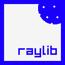

# Raylib-Lua Bindings

[](https://buymeacoffee.com/legendaryredfox)


This project provides bindings for **Raylib** (a simple and easy-to-use game development library) to be used with **Lua**, a powerful, efficient, lightweight scripting language. With this binding, you can use Raylib's functionalities directly from Lua scripts, enabling rapid development of games and graphical applications.

## Features

- **Complete raylib 6.2 API coverage** — every public `RLAPI` function in `raylib.h` is bound (628 callables exposed via `require("raylib")`, including a few compatibility aliases)
- **Simple, idiomatic Lua bindings** spanning **drawing**, **audio**, **textures**, **models**, **shaders**, **3D/2D cameras** & coordinate transforms, render-to-texture / blend / scissor modes, **gamepad/gesture/touch input**, **filesystem & data utilities**, VR, and automation events
- **Enum constants** — `raylib.KEY_A`, `raylib.MOUSE_BUTTON_LEFT`, `raylib.FLAG_VSYNC_HINT`, `raylib.PIXELFORMAT_*`, … (312 integers generated from `raylib.h` by `tools/gen_constants.py`), plus `PI`, `DEG2RAD`, `RAD2DEG` and `RAYLIB_VERSION*`
- **raymath** — 146 functions with their raymath names (`Vector2Add`, `Vector3CrossProduct`, `MatrixMultiply`, `QuaternionFromAxisAngle`, `Clamp`, `Lerp`, …). Vectors and quaternions are `{x,y,z[,w]}` tables, matrices are `{m0..m15}`. Generated by `tools/gen_raymath.py`
- **Scoped resources** — `local img <close> = raylib.LoadImage("a.png")` calls the matching `Unload*` when the scope ends, even on error. Unloading by hand first is safe
- `GetRenderTextureTexture(rt)` returns a `Texture2D` view of a render texture so it can be drawn with `DrawTexture*` (release it with `UnloadRenderTexture`, never `UnloadTexture`)
- Colors as `{r,g,b,a}` tables or named constants (`RED`, `RAYWHITE`, …); `ClearBackground` and `DrawRectangle` additionally accept a packed `0xRRGGBBAA` integer
- Autocomplete available for VSCode: https://marketplace.visualstudio.com/items?itemName=LegendaryRedfox.raylib-lua-bindings-autocomplete
- Easily extendable: Add more bindings as you go!

## Prerequisites

Before building this project, ensure you have the following software installed:

### On Linux:

1. **GCC**: C compiler used for compiling the bindings.
2. **Make**: A tool to automate the build process.
3. **libX11** development headers (usually `libx11-dev`).

Raylib 6.2 and Lua 5.5.1 sources are **vendored** in `raylib/` and `lua/` — no system installation required. The first `make` compiles them into static libraries, then builds `raylib.so`.

### On Windows:

1. **GCC (MinGW)**: C compiler used for compiling the bindings.
2. **Make**: A tool to automate the build process.

Raylib and Lua are built from the vendored sources here too; there is nothing else to download.

## Installation

### 1. Clone the repository

```bash
git clone https://github.com/legendaryredfox/raylib-lua-bindings.git
cd raylib-lua-bindings
```

### 2. Install dependencies

#### On Linux:

Install a C toolchain and the X11 development headers:

```bash
sudo apt install build-essential libx11-dev   # Debian/Ubuntu
```

Raylib and Lua are vendored, so nothing else is needed — `make` builds them from the bundled sources.

#### On Windows:

Download and install MinGW (GCC for Windows). Raylib and Lua are vendored, so nothing else is needed.

### 3. Build the project

Run the following command to compile and create the shared library:

```bash
make
```

The first run also compiles the vendored `raylib/src/libraylib.a` and `lua/src/liblua.a` (use `make -j8` to speed it up). This will generate the appropriate shared library file:

**Linux: raylib.so**
**Windows: raylib.dll**

### 4. Using the bindings

In your Lua script, you can require the Raylib bindings as follows:

```lua
local raylib = require("raylib")

-- Initialize the window
raylib.InitWindow(800, 600, "Raylib Lua Example")

-- Main game loop
while not raylib.WindowShouldClose() do
    raylib.BeginDrawing()
    raylib.ClearBackground(DARKGRAY)                          -- named color constant
    raylib.DrawText("Hello, Raylib and Lua!", 10, 10, 20, DARKGREEN)
    raylib.EndDrawing()
end

-- Close window
raylib.CloseWindow()
```

Colors are passed as a named constant or a `{r,g,b,a}` table. Named constants
exist both on the module (`raylib.RAYWHITE`) and as globals (`RAYWHITE`). A packed
32-bit integer (`0xRRGGBBAA`) is *additionally* accepted by `ClearBackground` and
`DrawRectangle`; every other function expects a table or named constant:

```lua
raylib.ClearBackground(raylib.RAYWHITE)               -- named constant on the module
raylib.ClearBackground(RAYWHITE)                      -- same constant as a global
raylib.ClearBackground({r=245, g=245, b=245, a=255})  -- explicit table
raylib.ClearBackground(0xF5F5F5FF)                    -- packed int (ClearBackground/DrawRectangle only)
raylib.DrawText("hi", 10, 10, 20, RAYWHITE)           -- other calls need a table/constant
```

### 5. Running tests

The suite (391 checks) covers text utilities and parsing, hashing (CRC32/MD5/SHA1/SHA256), color utilities and named colors, CPU-side image operations (generate/inspect/copy/transform), filesystem & path helpers, data (de)compression and base64, random sequences, and audio-handler validation — everything that runs without an open window or audio device.

```bash
make test        # headless suite, no window needed
make test-gl     # windowed checks (render textures, shaders, Draw*Ex) under Xvfb
make examples    # runs every script in examples/ for a few frames under Xvfb
```

Tests are plain Lua scripts in `tests/` run against the bundled `raylib.so`. The only requirement is a Lua 5.5 interpreter on `PATH`. `test-gl` and `examples` need `xvfb-run` (package `xvfb`), so no window appears on your screen; CI runs all three on every push.

After a raylib upgrade, regenerate the constants and raymath bindings with `python3 tools/gen_constants.py` and `python3 tools/gen_raymath.py`.

### 6. Cleaning up

To remove the object files and shared library:

```bash
make clean
```

This will delete the compiled object files and the generated shared library (raylib.so or raylib.dll).

| Make target | Effect |
|-------------|--------|
| `make` | Build vendored raylib/Lua if needed, compile all sources, link `raylib.so` / `raylib.dll` |
| `make test` | Run the Lua unit test suite |
| `make clean` | Remove object files and the shared library |
| `make distclean` | `clean`, plus the vendored raylib and Lua builds |

### Known Issues

- Builds and passes the full test suite on both Linux and Windows. GPU/audio-dependent bindings (rendering, hardware textures, audio playback, input) still require a window or audio device and are verified by running example scripts rather than the headless test suite.
- **Raylib 6.2 migration notes** (changes that can affect scripts written for 6.0):
  - `DrawCapsule` / `DrawCapsuleWires` take `(rings, slices)` — the order was `(slices, rings)` in 6.0.
  - `ImageColorContrast` takes an integer (`-100..100`).
  - `FileCopy` and `FileMove` return `0` on success (6.0: `1` and `-1`). `ChangeDirectory` still returns a boolean.
  - `ImageDrawRectangleLines` accepts both `(image, rec, thick, color)` and the new `(image, x, y, width, height, color)`; `ImageDrawRectangleLinesEx` is the rectangle form.
  - `ImageDraw` (rectangle form) still works; the new `ImageDrawImage`, `ImageDrawImageEx`, `ImageDrawImagePro` and `ImageDrawImageRec` mirror `DrawTexture*`.
  - `GetSplinePointBezierQuad` is now `GetSplinePointBezierQuadratic` (old name kept as an alias); `ImageDrawTriangleEx` is now `ImageDrawTriangleGradient` (old name kept as an alias).
- `GetTargetFPS` is exposed for API symmetry but raylib has no such function; it delegates to `GetFPS()`.
- Audio handlers (`AttachAudioStreamProcessor`, `AttachAudioMixedProcessor`, `SetAudioStreamCallback`) run on raylib's audio thread, each in its own private Lua state. They cannot capture locals (upvalues) and do not see the script's globals or the raylib module; keep handler state in the handler's own globals. Up to 16 handlers can be attached at once. A handler that raises an error is disabled and its message is printed to stderr.
- Raylib objects (textures, images, sounds, fonts, models, …) are returned as userdata and must be released with the matching `Unload*`; they are **not** garbage-collected automatically. Automatic `__gc` is intentionally omitted because raylib objects share ownership (a mesh inside a model, a texture inside a material), which would make blind finalization double-free. After `Unload*`, the userdata is zeroed so accidental reuse is a safe no-op rather than a use-after-free.
- Contributions to help resolve these issues are highly welcome.

### Contributing

If you would like to contribute, please feel free to fork the repository, submit issues, and create pull requests.

- Fork the repository
- Create a feature branch
- Commit your changes
- Push to the branch
- Open a pull request
